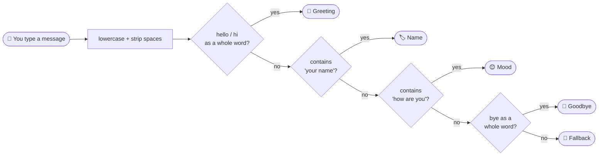

<div align="center">



<br/>

[](https://www.python.org/)
[](https://jupyter.org/)
[](https://colab.research.google.com/github/techprem324/ai-voice-assistant/blob/main/ai_voice_assistant.ipynb)
[](LICENSE)

[](https://github.com/techprem324/ai-voice-assistant/stargazers)
[](https://github.com/techprem324/ai-voice-assistant/network/members)
[](https://github.com/techprem324/ai-voice-assistant/issues)
[](#-contributing)
[](#-contributing)

**A tiny, readable Python chatbot you can run in one click — and a friendly place to make your first open-source contribution.** 🐱

[▶ Try it in Colab](https://colab.research.google.com/github/techprem324/ai-voice-assistant/blob/main/ai_voice_assistant.ipynb) · [💬 See a chat](#-see-it-in-action) · [🛠 Run locally](#-installation--setup) · [🤝 Contribute](#-contributing)

</div>


## 📑 Table of Contents

- [✨ What is this?](#-what-is-this)
- [💬 See it in action](#-see-it-in-action)
- [🎯 Features](#-features)
- [🐞 The greeting bug (and the fix)](#-the-greeting-bug-and-the-fix)
- [🧩 How it works](#-how-it-works)
- [🧰 Tech stack](#-tech-stack)
- [📁 Project structure](#-project-structure)
- [🚀 Installation & setup](#-installation--setup)
- [▶️ How to run the notebook](#️-how-to-run-the-notebook)
- [🗨️ Example conversations](#️-example-conversations)
- [🤝 Contributing](#-contributing)
- [🗺 Roadmap](#-roadmap)
- [📜 License & acknowledgements](#-license--acknowledgements)


## ✨ What is this?

This repository holds an AI assistant that goes by two names:

| Name | Where you see it |
|------|------------------|
| **Zia** | The repository's original title and description |
| **Kitty** 🐱 | The persona in the code — the chatbot actually introduces itself as Kitty |

Both names refer to the same project. In this README the assistant is called **Kitty**, because that is what you will talk to when you run the notebook.

> **Honest status:** today the project is a **text-based, keyword-matching chatbot** written in plain Python inside a Jupyter Notebook. It does **not** (yet) include speech recognition, voice output, or real NLP/AI models — those appear on the [roadmap](#-roadmap) as ideas, not as finished features.


## 💬 See it in action

<div align="center">
  
</div>


## 🎯 Features

| | Feature | Status |
|---|---------|:------:|
| 👋 | Greets you when you say **hello** or **hi** | ✅ Working |
| 🏷️ | Answers **"your name"** questions | ✅ Working |
| 😊 | Answers **"how are you"** | ✅ Working |
| 🚪 | Says goodbye when you say **bye** | ✅ Working |
| 🤷 | Friendly fallback for anything it doesn't understand | ✅ Working |
| 🔠 | Case-insensitive matching (`HELLO`, `Hi`, `hello`) | ✅ Working |
| 🎯 | Word-boundary matching for greetings & goodbye (regex) | ✅ Working in this branch |
| 🎤 | Speech recognition / voice replies | 💡 Planned |


## 🐞 The greeting bug (and the fix)

The original code checked greetings with a plain substring test, so `"hi"` was found *inside* other words like **t<ins>hi</ins>s** and **<ins>hi</ins>story** — and Kitty greeted you for no reason.

<div align="center">
  
</div>

```diff
- if "hello" in user_input or "hi" in user_input:
+ if re.search(r"\b(hello|hi)\b", user_input):
```

The `\b` in the regular expression means *word boundary*, so only the whole words `hello` and `hi` match. The same treatment was applied to the goodbye keyword (`\bbye\b`).

| Message | Before | After |
|---------|:------:|:-----:|
| `hi` | 👋 greeting | 👋 greeting |
| `this is interesting` | 👋 greeting *(bug)* | 🤷 fallback |
| `history is important` | 👋 greeting *(bug)* | 🤷 fallback |

**Fix included:** this branch updates the notebook to use whole-word matching, so `hi` no longer matches inside words such as `this` or `history`.


## 🧩 How it works

Every message goes through one function, `kitty_chat()`. The first rule that matches wins.



The core of the bot, from the fixed notebook:

```python
import re

def kitty_chat(user_input):
    user_input = user_input.lower().strip()

    if re.search(r"\b(hello|hi)\b", user_input):
        return "Hello! I'm Kitty 🐱. How can I help you?"

    elif "your name" in user_input:
        return "My name is Kitty, your AI assistant."

    elif "how are you" in user_input:
        return "I'm doing great! Thanks for asking 😊"

    elif re.search(r"\bbye\b", user_input):
        return "Goodbye! Talk to you soon 👋"

    else:
        return "I'm still learning. Can you ask something else?"
```


## 🧰 Tech stack

<div align="center">


</div>

- **Python 3** — the whole bot is plain Python.
- **`re` module** — part of Python's standard library, used for word-boundary matching. **No packages to install.**
- **Jupyter Notebook / Google Colab** — where the code lives and runs.


## 📁 Project structure

```text
ai-voice-assistant/
├── 📓 ai_voice_assistant.ipynb   # The chatbot: kitty_chat() + demo cells
├── 🎨 assets/                    # Animated SVGs used by this README
│   ├── banner.svg
│   ├── chat-demo.svg
│   ├── bug-vs-fix.svg
│   └── divider.svg
├── 📄 README.md                  # You are here
├── ⚖️ LICENSE                    # MIT License
└── 🙈 .gitignore                 # Files Git should ignore
```


## 🚀 Installation & setup

You can run Kitty with **zero setup** in Colab, or locally in a few commands.

### Option A — Google Colab (easiest)

1. Click **[Open in Colab](https://colab.research.google.com/github/techprem324/ai-voice-assistant/blob/main/ai_voice_assistant.ipynb)**.
2. Run the cells from top to bottom. That's it. ✅

### Option B — Run locally

**Requirements:** Python 3 and Jupyter. Nothing else.

```bash
# 1. Clone the repository
git clone https://github.com/techprem324/ai-voice-assistant.git
cd ai-voice-assistant

# 2. (Optional) create a virtual environment
python -m venv .venv
source .venv/bin/activate        # Windows: .venv\Scripts\activate

# 3. Install Jupyter
pip install notebook

# 4. Launch the notebook
jupyter notebook ai_voice_assistant.ipynb
```


## ▶️ How to run the notebook

1. Open `ai_voice_assistant.ipynb`.
2. Run the cells **in order** (`Shift + Enter`). The first code cells define `kitty_chat()`; later cells try it out.
3. Want to talk to Kitty yourself? Add a new cell, paste this, and run it:

```python
while True:
    user = input("You: ")

    if user.lower() == "exit":
        print("Kitty: Bye! 👋")
        break

    print("Kitty:", kitty_chat(user))
```

Type `exit` to stop the loop.

> 💡 If you see `NameError: name 'kitty_chat' is not defined`, you skipped the cell that defines the function — run the notebook from the top.


## 🗨️ Example conversations

Real output from `kitty_chat()` (fixed version):

```text
You: hi
Kitty: Hello! I'm Kitty 🐱. How can I help you?

You: what is your name?
Kitty: My name is Kitty, your AI assistant.

You: how are you?
Kitty: I'm doing great! Thanks for asking 😊

You: history is important
Kitty: I'm still learning. Can you ask something else?

You: this is interesting
Kitty: I'm still learning. Can you ask something else?

You: HELLO
Kitty: Hello! I'm Kitty 🐱. How can I help you?

You: bye
Kitty: Goodbye! Talk to you soon 👋
```

> Notice that `history` and `this` no longer trigger a greeting — whole-word matching prevents those false positives.


## 🤝 Contributing

**New to open source? You're exactly who this project is for.** The whole bot is one small function, so it's an easy place to learn the GitHub workflow.

### 🌱 Good first ideas

- Add a new reply (for example `"thank you"` or `"help"`).
- Make Kitty recognise `"goodbye"` as well as `"bye"`.
- Improve the wording of an existing reply.
- Fix a typo or improve this README.

### 🔁 Step by step

```bash
# 1. Fork the repo on GitHub, then clone YOUR fork
git clone https://github.com/<your-username>/ai-voice-assistant.git
cd ai-voice-assistant

# 2. (Once) connect the original repo so you can stay up to date
git remote add upstream https://github.com/ghosalofficial10-dev/ai-voice-assistant.git

# 3. Create a branch for your change
git checkout -b feat/my-awesome-change

# 4. Edit the notebook, run it, make sure Kitty still behaves

# 5. Commit with a clear message
git add .
git commit -m "feat: add reply for thank you"

# 6. Push and open a Pull Request
git push origin feat/my-awesome-change
```

### ✅ Before you open a PR

- [ ] Run the notebook from top to bottom with no errors.
- [ ] Try a few messages to confirm old replies still work.
- [ ] Keep the change small and focused — one idea per PR.
- [ ] Use a clear commit message, like `fix: ...` or `feat: ...`.

Not sure where to start? Open an [issue](https://github.com/techprem324/ai-voice-assistant/issues) and ask — questions are welcome. 💜


## 🗺 Roadmap

**Legend:** ✅ done · 🔄 in review · 💡 idea (not implemented)

- [x] ✅ Keyword-based replies for greeting, name, mood and goodbye
- [x] ✅ Friendly fallback reply
- [x] ✅ Word-boundary greeting detection for `hello`, `hi`, and `bye`
- [ ] 💡 Recognise `"goodbye"` (word-boundary matching currently only matches the standalone word `bye`)
- [ ] 💡 More intents (thanks, help, time/date, jokes)
- [ ] 💡 Move `kitty_chat()` into a `.py` file and add automated tests
- [ ] 💡 Speech input with a speech-recognition library
- [ ] 💡 Spoken replies with a text-to-speech library
- [ ] 💡 Smarter understanding with NLP

> Items marked 💡 are **ideas for the future**, not features that exist today.


## 📜 License & acknowledgements

Released under the **[MIT License](LICENSE)**.

- 🙌 Original project by **[ghosalofficial10-dev](https://github.com/ghosalofficial10-dev/ai-voice-assistant)** — thank you for the starting point.
- 🛠️ Greeting-detection fix and README by **[techprem324](https://github.com/techprem324)**.
- 🏷️ Badges by [Shields.io](https://shields.io/).

<div align="center">

⭐ **If Kitty made you smile, consider giving the repo a star!** ⭐

</div>
